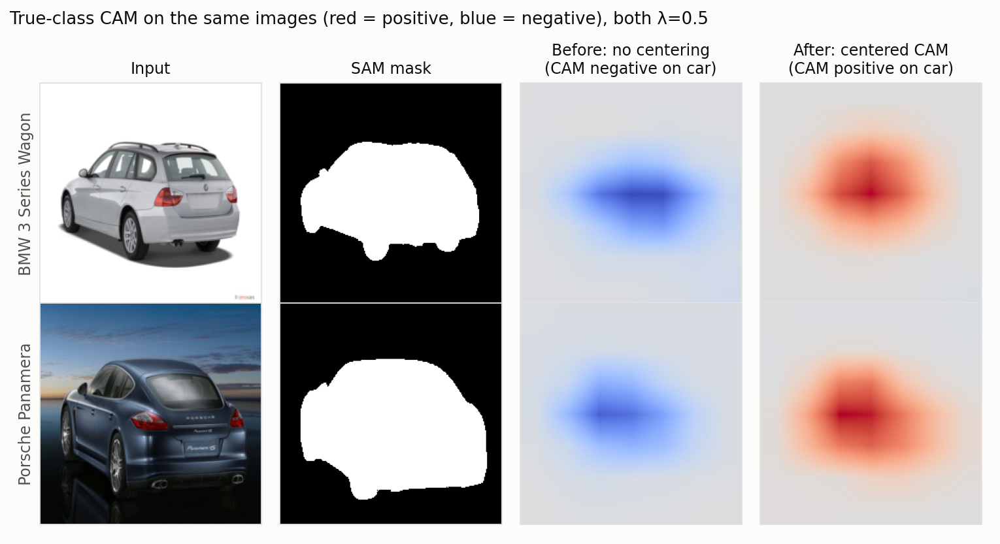
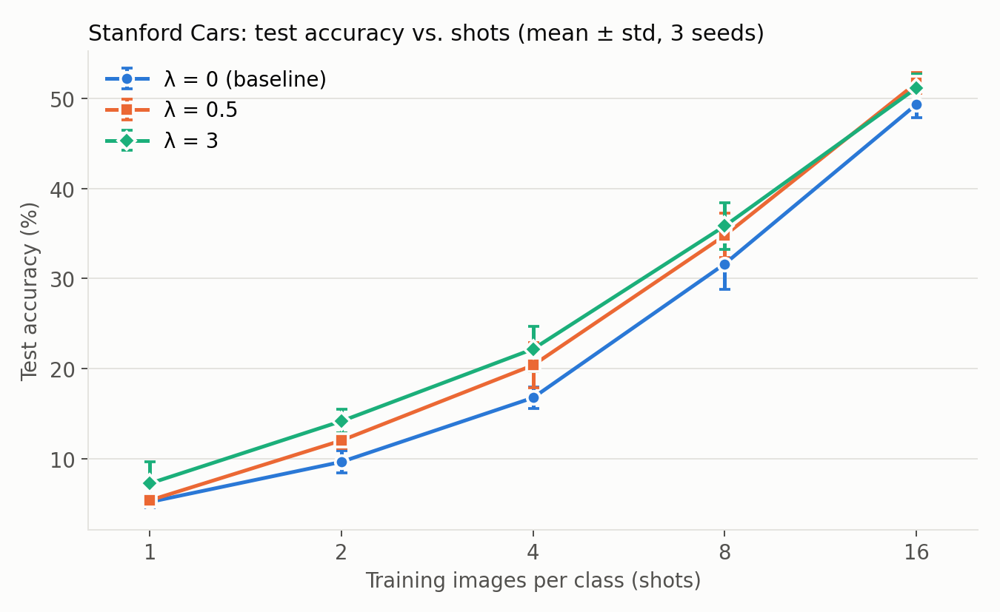
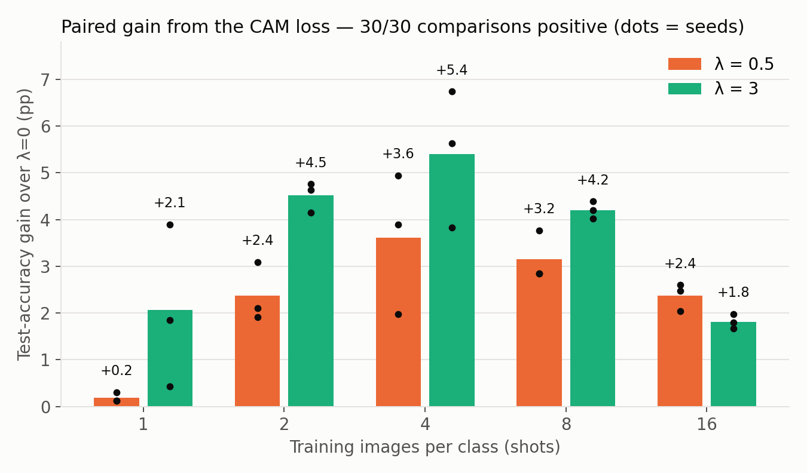

# SAM Pseudo-Masks as a Spatial Prior for Few-Shot Fine-Grained Classification

**Progress report** · Soroush Akhavan · 2026-11-03

---

## 1. Goal

Few-shot fine-grained classification (Stanford Cars, 196 classes, 1–16 images per class) with a frozen pretrained backbone and lightweight adapters.

**Idea:** use free SAM pseudo-masks of the object to tell the model *where* the evidence should come from.

```text
loss = CrossEntropy(GAP(CAM), y)  +  λ · CAM-localization-loss(CAM of true class, SAM mask)
```

| Component | Choice |
|---|---|
| Backbone | BiT-M R50x1 (ImageNet-21k), frozen; Conv-Adapters (γ=8) trainable, ~2.8M params |
| Head | 1×1 conv → per-class CAM (7×7), logits = global average pool of the CAM |
| Masks | SAM pseudo-masks; 14,393 of 16,183 images have one |
| Localization loss | squared containment: share of CAM energy (CAM²) outside the mask |

---

## 2. What went wrong first: the CAM flipped sign

The first versions of the loss "worked" numerically but produced **inverted CAMs**: strongly negative on the car, so the visible peak landed on the background.

| Metric (Stanford Cars, early runs) | Value |
|---|---|
| Pointing game (CAM peak inside mask) | **0.08** (chance ≈ 0.3) |
| Images whose true-class CAM is negative everywhere | **up to 70%** |
| True-class CAM inside the mask (mean, signed) | **−34 to −38** |



*Same images, both λ=0.5. "Before" is the earlier all-class squared loss without centering; "after" is the squared loss with class-centering. Red = positive, blue = negative.*

---

## 3. Why it happens: a free degenerate solution

Split each class map into a component shared by all classes and a class-specific part:

```text
CAM_k(x) = s(x) + r_k(x),      s(x) = mean over classes of CAM_k(x)
```

1. **Cross-entropy cannot see `s`.** Logits are GAP(CAM_k), so `s` shifts every logit equally, and softmax is shift-invariant. The CE gradient on `s` is exactly zero.
2. **A squared (sign-blind) localization loss can be satisfied through `s`.** A large *negative* `s` on the object puts most of the CAM² energy inside the mask, so the loss goes down, while CE doesn't notice.
3. **Averaging the loss over all K classes makes it worse.** The only single change that lowers all 196 terms at once is `s`.

Measured on Stanford Cars: `s` ≈ −58 inside the mask, `r_true` ≈ +24, so the true-class CAM ≈ −34. The class-specific signal was correct all along; the shared term hid it.

---

## 4. The fix: class-centering (one line, provably harmless)

```python
cams = cams - cams.mean(dim=1, keepdim=True)   # remove s(x) at every cell
```

- **Predictions are unchanged:** all logits shift by the same amount, so softmax probabilities are identical (verified to ~1e-7).
- **The escape route is closed:** with `s ≡ 0`, the logits sum to zero, so the true class must be **positive** to win under CE. The localization loss can then only be met by a positive CAM on the object.

| After the fix (16 shots, λ=0.5) | Before | After |
|---|---|---|
| True-class CAM inside / outside mask | −37.7 / −8.0 | **+25.3 / +4.4** |
| Fully negative CAMs | 70% | **0%** |
| Pointing game | 0.08 | **0.84** |

*"Before" is the all-class squared loss without centering; "after" is the true-class squared loss with centering. Both runs: λ=0.5, 16 shots, same data and split.*

*Caveat: on Cars a "point at the image centre" baseline already scores 0.81, so I don't use pointing as main evidence. Threshold-free pixel AUC: 0.837 (λ=0) → 0.875 (λ=0.5).*

---

## 5. Main result: multi-seed sweep

45 runs: shots ∈ {1, 2, 4, 8, 16} × λ ∈ {0, 0.5, 3} × seeds {42, 43, 44}. 15 epochs, checkpoint selected on validation CE after the λ warm-up.



| shots | λ=0 | λ=0.5 | λ=3 |
|---|---|---|---|
| 1 | 5.2 ± 0.7 | 5.4 ± 0.6 | **7.3 ± 2.4** |
| 2 | 9.7 ± 1.2 | 12.1 ± 0.9 | **14.2 ± 1.3** |
| 4 | 16.8 ± 1.2 | 20.4 ± 2.5 | **22.2 ± 2.5** |
| 8 | 31.6 ± 2.8 | 34.8 ± 2.4 | **35.8 ± 2.6** |
| 16 | 49.3 ± 1.4 | **51.7 ± 1.1** | 51.1 ± 1.5 |

*Test accuracy (%), mean ± std over 3 seeds. The std is mostly split noise: each seed uses a different train/val/test split.*

---

## 6. The gain is consistent: paired comparison

Within a seed, λ=0 and λ>0 share the same split and the same training images, so the comparison is paired.



| | Mean gain | Positive pairs | Sign test | Wilcoxon |
|---|---|---|---|---|
| λ=0.5 | **+2.3 pp** | 15/15 | p = 0.0001 | p = 0.0001 |
| λ=3 | **+3.6 pp** | 15/15 | p = 0.0001 | p = 0.0001 |

- **30 of 30 paired comparisons are positive** (validation accuracy agrees: 30/30).
- λ=3 helps most at 2–8 shots: **+4.2 to +5.4 pp** (+47% relative at 2 shots).
- Paired gains are tight, e.g. +4.20 ± 0.19 pp at 8 shots, much tighter than the raw ±2.6 pp seed spread.
- **Mechanism (from the training curves):** the CAM loss reduces overfitting. With λ=0, validation CE starts rising after ~epoch 8; with λ>0 it keeps improving until the end of training.

---

## 7. Localization improves with λ at every shot level

| shots | λ=0 | λ=0.5 | λ=3 |
|---|---|---|---|
| 2 | 0.51 | 0.43 | **0.33** |
| 8 | 0.46 | 0.36 | **0.27** |
| 16 | 0.44 | 0.33 | **0.24** |

*Containment = share of CAM energy outside the mask (lower is better; a flat CAM scores ≈ 0.68). λ>0 values are means over 3 seeds (std ≤ 0.01). λ=0 values are from seed 42 only.*

---

## 8. Honest limitations

| Limitation | Impact |
|---|---|
| **No data augmentation in any run so far.** A data-loading bug silently disabled it; now fixed and tested. | The gain may partly be regularization that augmentation already provides. **This is the most important open question.** |
| **Weak absolute baseline** (≈49% at 16 shots) | Strong few-shot methods (e.g. CLIP-based adapters) score much higher on Cars; gains on a weak baseline are less convincing. |
| One dataset, one backbone | Needs CUB-200, FGVC-Aircraft, and a second backbone (CLIP or DINOv2). |
| No comparison with simpler uses of the masks or with prior attention-supervision methods | E.g. background removal at train time, background-swap augmentation, GAIN-style losses. |
| 3 seeds, two environments (local GPU and Kaggle) | Paired gains remain valid; the next sweep will run in one environment. |
| Novelty not yet checked against the literature | The centering degeneracy may already be described somewhere. |

---

## 9. Engineering notes

- Experiments are reproducible from the repo: exact code snapshot, Kaggle kernel builder, per-run results ([results/seed_sweep/](../results/seed_sweep/)).
- Kaggle (T4×2) runs two seeds in parallel; a CPU smoke test checks that masks load and the CAM loss is live before any long run.
- Three silent bugs were found and fixed along the way, each now covered by a test:
  1. early stopping monitored a loss that grew with the λ warm-up, so every λ>0 run stopped right after warm-up;
  2. augmentation was skipped by the DataLoader;
  3. on Linux, Windows-style mask paths matched no file, so the CAM loss was zero.

---

## 10. Plan and possible paper

**Proposed framing:**

> Localization losses on GAP-CAM heads admit a degenerate class-shared solution. Class-centering removes it at no cost and turns free SAM pseudo-masks into an effective spatial prior for few-shot fine-grained adaptation.

| Step | Purpose | Effort |
|---|---|---|
| 1. Rerun λ ∈ {0, 3} **with augmentation**, 3 seeds | Does the gain survive standard regularization? (go / no-go) | ~1 day (Kaggle) |
| 2. Baseline: mask the background at train time | Is the loss better than the simplest use of the masks? | ~1 day |
| 3. Add CUB-200 and FGVC-Aircraft | Generality | ~1 week |
| 4. Stronger backbone (CLIP ViT-B/16 or DINOv2) | Address the weak-baseline concern | ~1–2 weeks |
| 5. Literature review (attention/CAM supervision, the degeneracy) | Novelty | parallel |

**Target:** a workshop paper after steps 1–3 and 5; a main-venue submission (e.g. WACV/BMVC) after all five.

---

## 11. Questions for you

1. Is **workshop first, then a full paper** the right path, or should we aim directly for a full paper?
2. Which **backbone** would you prefer for the strong-baseline experiments: CLIP, DINOv2, or keep BiT?
3. Which **datasets** matter most for our group: CUB, Aircraft, Flowers, Pets?
4. Do you know of **prior work** on the class-shared degeneracy of CAM/attention supervision?
5. GPU budget: is Kaggle (≈30 GPU-h/week) enough, or can I use lab GPUs for the larger sweeps?
