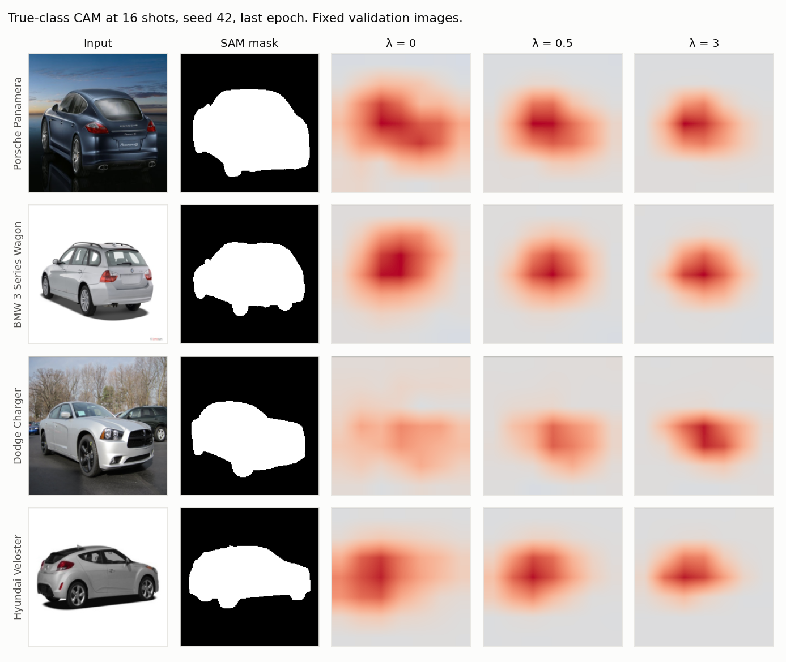
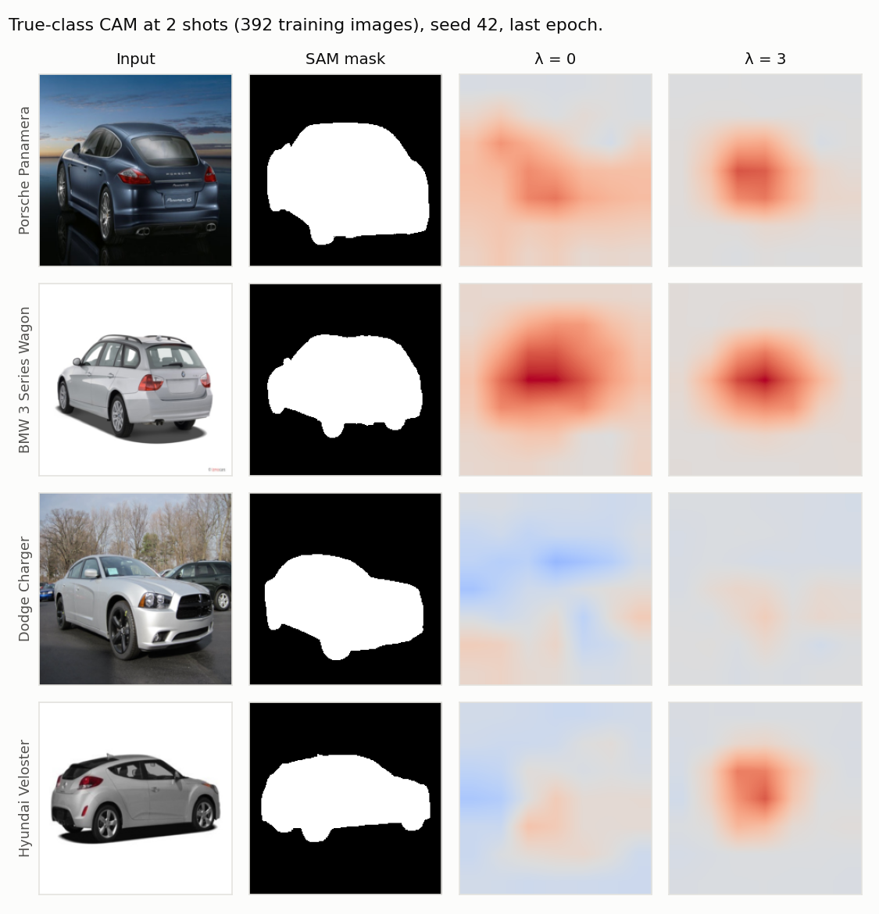
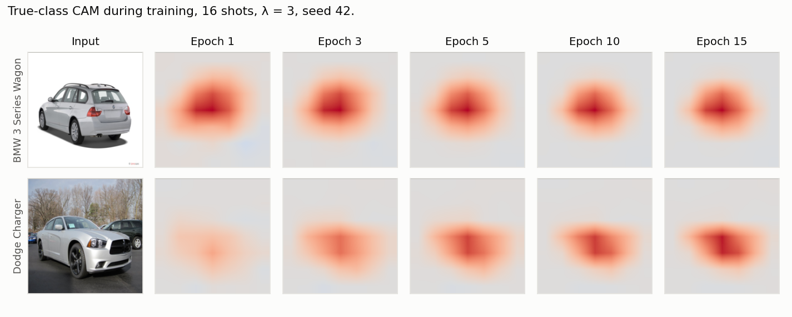
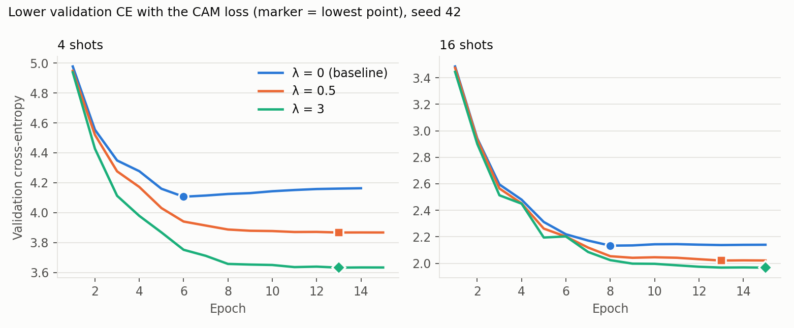
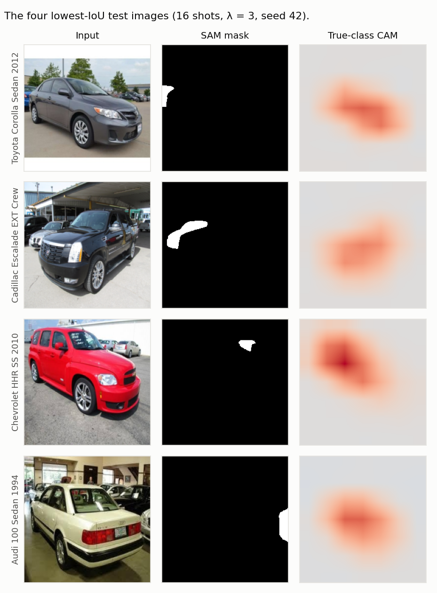
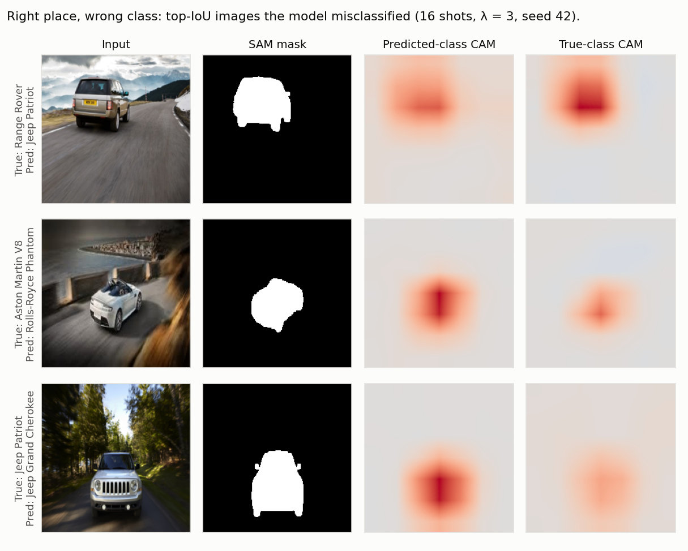

# SAM Pseudo-Masks as a Spatial Prior for Few-Shot Fine-Grained Classification

**Progress report** · Soroush Akhavan · 2026-11-09

**In one slide:**

- Early versions of the CAM loss produced inverted CAMs. The cause is a degenerate solution that cross-entropy cannot see, and a one-line class-centering removes it.
- With the fix, the CAM loss raises few-shot accuracy on Stanford Cars in **30 of 30 paired comparisons** (3 seeds): +2.3 pp on average for λ=0.5 and +3.6 pp for λ=3.
- Main open question: **no run has used data augmentation yet**, so the gain may partly overlap with standard regularization.

---

## 1. Goal and setup

Few-shot fine-grained classification with a frozen pretrained backbone and lightweight adapters.

**Idea:** use free SAM pseudo-masks of the object to tell the model *where* the evidence should come from.

```text
loss = CrossEntropy(GAP(CAM), y)  +  λ · localization_loss(CAM of true class, SAM mask)
```

| Component | Choice |
|---|---|
| Data | Stanford Cars, 196 classes; split 11,329 / 3,236 / 1,618 (train / val / test) |
| Few-shot training set | 1, 2, 4, 8 or 16 images per class (16 shots = 3,136 images) |
| Backbone | BiT-M R50x1 (ImageNet-21k), frozen; Conv-Adapters (γ=8) and GroupNorm trainable, ~2.8M params |
| Head | 1×1 conv → per-class CAM (7×7); logit = global average pool of the CAM |
| Masks | SAM pseudo-masks; 14,393 of 16,183 images have one |
| Training | 15 epochs, AdamW, lr 3e-4, cosine, batch 8; λ warm-up over 3 epochs; **no augmentation** |

---

## 2. The localization loss, by example

**Squared containment** is the share of CAM energy (CAM²) that falls outside the mask:

```text
containment = Σ CAM² · (1 − mask) / Σ CAM²        0 = all on the object, 1 = all on the background
```

Toy 3×3 example; the object fills the middle row:

| Case | CAM rows | Containment |
|---|---|---|
| Good: peak on object | `1 1 1` / `4 6 4` / `0 2 0` | 7 / 75 = **0.09** |
| Bad: peak on background | `6 4 6` / `1 1 1` / `0 0 0` | 88 / 91 = **0.97** |
| Flat: no spatial information | `2 2 2` / `2 2 2` / `2 2 2` | 6 / 9 = **0.67** |
| **Negative on object** | `1 1 1` / `−4 −6 −4` / `0 2 0` | 7 / 75 = **0.09** ⚠️ |

The last row is the problem: squaring hides the sign, so a map that is strongly *negative* on the object gets the same low loss as the good map.

---

## 3. What went wrong first: the CAM flipped sign

Early versions lowered the loss but produced **inverted CAMs**.

| Metric (Stanford Cars, early runs) | Value |
|---|---|
| Pointing game (CAM peak inside mask) | **0.08** (chance ≈ 0.3) |
| Images whose true-class CAM is negative everywhere | **up to 70%** (probe on 168 test images) |
| True-class CAM inside the mask (mean, signed) | **−34 to −38** |


*Same images, both λ=0.5. "Before" is the earlier all-class squared loss without centering; "after" is the true-class squared loss with centering. Red = positive, blue = negative.*

The raw output for these two images:

| Image | True-class CAM range, before | True-class CAM range, after |
|---|---|---|
| BMW 3 Series Wagon | [−107.8, +1.6] | [−3.3, **+106.0**] |
| Porsche Panamera | [−116.0, −1.0] (entirely negative) | [−2.3, **+80.3**] |

---

## 4. Why it happens: a free degenerate solution

Split each class map into a component shared by all classes and a class-specific part:

```text
CAM_k(x) = s(x) + r_k(x),      s(x) = mean over classes of CAM_k(x)
```

1. **Cross-entropy cannot see `s`.** Logits are GAP(CAM_k), so `s` shifts every logit equally, and softmax is shift-invariant. The CE gradient on `s` is exactly zero.
2. **A sign-blind localization loss can be satisfied through `s`.** A large *negative* `s` on the object puts most of the CAM² energy inside the mask. The loss goes down and CE doesn't notice.
3. **Averaging the loss over all K classes makes it worse.** The only single change that lowers all 196 terms at once is `s`.

Example with one cell on the car and 3 classes (values based on the measured means below):

| Class | CAM | `s` | `r_k` |
|---|---|---|---|
| True class | **−34** | −58 | **+24** |
| Class 2 | −66 | −58 | −8 |
| Class 3 | −74 | −58 | −16 |

CE is satisfied because −34 is the largest value, and the loss is satisfied because (−34)² is large and sits on the car. But the plotted map is blue on the car.

**Measured on Cars (all-class loss, λ=10):** inside the mask, `s` ≈ −58, `r_true` ≈ +24 and the true-class CAM ≈ −34. Outside the mask, `r_true` ≈ +4, so the class-specific signal was already on the car; the shared term hid it.

---

## 5. The fix: class-centering

```python
cams = cams - cams.mean(dim=1, keepdim=True)   # remove s(x) at every cell
```

The same cell, after centering: true class **+24**, class 2 −8, class 3 −16. Differences between classes are unchanged.

- **Predictions are unchanged:** all logits shift by the same amount, so softmax probabilities are identical (verified to ~1e-7).
- **The free solution is gone:** with `s ≡ 0`, the logits sum to zero, so the predicted class always has a positive mean CAM. A negative true-class CAM on the object now costs CE or localization loss.

| 16 shots, λ=0.5 | Before | After |
|---|---|---|
| True-class CAM inside / outside mask | −37.7 / −8.0 | **+25.3 / +4.4** |
| Fully negative CAMs | 70% | **0%** |
| Pointing game | 0.08 | **0.84** |

*"Before" is the all-class squared loss without centering; "after" is the true-class squared loss with centering, so this table compares both changes together. Both runs: same data and split. In the "after" run, the true-class CAM is still negative on the object for 1.6% of misclassified images: there the true class scores below the class average.*

---

## 6. Main result: multi-seed sweep

45 runs: shots ∈ {1, 2, 4, 8, 16} × λ ∈ {0, 0.5, 3} × seeds {42, 43, 44}. Checkpoint selected on validation CE after the λ warm-up.


| shots | λ=0 | λ=0.5 | λ=3 |
|---|---|---|---|
| 1 | 5.2 ± 0.7 | 5.4 ± 0.6 | **7.3 ± 2.4** |
| 2 | 9.7 ± 1.2 | 12.1 ± 0.9 | **14.2 ± 1.3** |
| 4 | 16.8 ± 1.2 | 20.4 ± 2.5 | **22.2 ± 2.5** |
| 8 | 31.6 ± 2.8 | 34.8 ± 2.4 | **35.8 ± 2.6** |
| 16 | 49.3 ± 1.4 | **51.7 ± 1.1** | 51.1 ± 1.5 |

*Test accuracy (%), mean ± std over 3 seeds. The std is mostly split noise: each seed uses a different train/val/test split.*

The raw per-seed numbers show why the comparison has to be paired: differences between seeds are often larger than the gain, but λ>0 beats λ=0 within every seed.

| shots | λ | Seed 42 | Seed 43 | Seed 44 |
|---|---|---|---|---|
| 2 | 0 | 11.1 | 8.8 | 9.1 |
| 2 | 3 | 15.7 | 13.6 | 13.3 |
| 8 | 0 | 34.7 | 30.8 | 29.4 |
| 8 | 3 | 38.8 | 35.0 | 33.7 |
| 16 | 0 | 50.8 | 49.1 | 48.0 |
| 16 | 3 | 52.8 | 50.8 | 49.8 |

---

## 7. The gain is consistent: paired comparison

Within a seed, λ=0 and λ>0 share the same split and the same training images.


| shots | λ=0.5 gain (pp) | p | λ=3 gain (pp) | p |
|---|---|---|---|---|
| 1 | +0.19 ± 0.11 | 0.095 | +2.06 ± 1.74 | 0.18 |
| 2 | +2.37 ± 0.63 | 0.023 | **+4.51 ± 0.33** | 0.002 |
| 4 | +3.61 ± 1.50 | 0.053 | **+5.40 ± 1.47** | 0.024 |
| 8 | +3.15 ± 0.54 | 0.009 | **+4.20 ± 0.19** | 0.001 |
| 16 | **+2.37 ± 0.29** | 0.005 | +1.81 ± 0.16 | 0.002 |

*Paired t-test, df = 2. With only 3 seeds, the pooled tests below are the stronger evidence.*

| Pooled over shots | Mean gain | Positive pairs | Sign test | Wilcoxon |
|---|---|---|---|---|
| λ=0.5 | **+2.3 pp** | 15/15 | p = 0.0001 | p = 0.0001 |
| λ=3 | **+3.6 pp** | 15/15 | p = 0.0001 | p = 0.0001 |

- **30 of 30 paired comparisons are positive**; validation accuracy agrees (30/30).
- λ=3 helps most at 2–8 shots (+47% relative at 2 shots, +4% at 16 shots).
- 1 shot is the weak spot: the λ=3 gain ranges from +0.4 to +3.9 pp across seeds.

---

## 8. What the CAMs look like: effect of λ

The same fixed validation images across runs, not hand-picked: the snapshot code selects them with a fixed seed before training.



*16 shots: larger λ gives tighter maps that spill less onto the background (Porsche, Veloster). The Charger map becomes stronger and better placed.*



*2 shots: the difference is clearer. Without the loss, maps are diffuse and spread to the background (Porsche, Veloster). λ=3 concentrates them on the car. The Charger is still weak in both, so the loss doesn't fix every image.*

*Reading note: colors are scaled per image and per run, so compare **where** the map is, not its absolute strength across columns. Snapshots show the last epoch, which is epoch 13 for λ=0 at 2 shots.*

---

## 9. How the CAM forms during training



*16 shots, λ=3. The BMW map is already on the car at epoch 1, so part of the localization comes from the pretrained features; training then tightens it. The Charger starts weak and builds up gradually.*

---

## 10. Why accuracy improves: less overfitting (the likely mechanism)



Epoch of lowest validation CE, over all 15 runs for each λ (5 shot levels × 3 seeds):

| | λ=0 | λ=0.5 | λ=3 |
|---|---|---|---|
| Median epoch of lowest validation CE | **6** | **15** | **14** |
| Range | 3–15 | 3–15 | 3–15 |

- Without the loss, validation CE usually stops improving early and then stays flat or rises. With it, CE reaches a lower value and tends to keep improving to the end of training.
- At 16 shots (seed 42), lowest validation CE drops from 2.13 (λ=0) to 2.02 (λ=0.5) and 1.97 (λ=3), while final training CE goes **up** from 0.010 to 0.015 and 0.025. So the model memorizes the training set a little less.
- This is an interpretation from the curves, not a controlled test of the mechanism.
- Most λ>0 runs reach their lowest point near the 15-epoch cap, so they might gain more from longer training.

---

## 11. Localization metrics, and one misleading metric

**Containment** (share of CAM energy outside the mask; lower is better; a flat CAM scores ≈ 0.68):

| shots | λ=0 | λ=0.5 | λ=3 |
|---|---|---|---|
| 2 | 0.51 | 0.43 | **0.33** |
| 8 | 0.46 | 0.36 | **0.27** |
| 16 | 0.44 | 0.33 | **0.24** |
| 16, healthy masks only (seed 42) | 0.36 | 0.23 | **0.14** |

*λ>0 values are means over 3 seeds (std ≤ 0.01). λ=0 values are from seed 42 only, because the Kaggle λ=0 runs had no masks loaded (their accuracy is still valid: λ=0 never uses masks). "Healthy" means the mask covers at least 5% of the CAM grid.*

**IoU at a fixed threshold points the other way:** at 16 shots (seed 42), IoU@0.5 is 0.43 / 0.36 / 0.28 for λ = 0 / 0.5 / 3. This comes from the threshold. A sharper CAM leaves less area above 50% of its peak. From a separate 20-epoch pair of runs (16 shots):

| Threshold on normalized CAM | IoU, λ=0.5 | IoU, λ=0 | Area above threshold, λ=0.5 | Area, λ=0 |
|---|---|---|---|---|
| 0.2 | **0.60** | 0.49 | 34% | 56% |
| 0.3 | **0.52** | 0.52 | 25% | 43% |
| 0.4 | 0.43 | **0.50** | 19% | 32% |
| 0.5 | 0.33 | **0.44** | 15% | 24% |

*Threshold-free pixel AUC on the same pair: **0.875** (λ=0.5) vs 0.837 (λ=0).*

**Pointing is not informative on this dataset:** always pointing at the image centre already scores 0.81, because cars are centered. The sweep scores 0.83–0.85 at 16 shots.

---

## 12. Finding: many of the "worst" results are SAM failures



*The four lowest-IoU test images. In each one the CAM is on the main car, and SAM segmented something else (a car in the background or a small fragment).*

Numbers at 16 shots, seed 42, λ=3:

| | Tiny masks (under 5% of the CAM grid) | Healthy masks |
|---|---|---|
| Share of masked test images | **13%** (187 of 1,433) | 87% |
| Pointing game | 0.00 | **0.97** |
| Containment | 0.99 | **0.14** |
| Accuracy | 0.58 | 0.52 |

- **182 of the 210 test images with IoU = 0 have a tiny mask.**
- These masks lower the reported localization, and in training they push the CAM toward the wrong place. They are not filtered yet.
- On healthy masks, the centre baseline for pointing can be at most about 0.94 (0.81 × 1,433 / 1,246), so 0.97 is only slightly better; containment is the better evidence.

**Simple next step:** exclude tiny masks from the loss. This may increase the gain.

---

## 13. Finding: errors are about the class, not the location



*Misclassified images from the top-IoU list, so these are chosen as clear examples rather than a typical sample. Both CAMs are on the car, and the confusion is between similar models. The logit is the mean of the whole map, so a stronger peak doesn't guarantee the higher logit (top row).*

Across the test set (16 shots, seed 42, λ=3), the pointing score is **0.86 for misclassified** and **0.83 for correct** images. So misclassified images are localized just as well, and better localization alone won't fix these errors. The gain probably comes through regularization rather than from correcting "wrong place" mistakes.

---

## 14. Honest limitations

| Limitation | Impact |
|---|---|
| **No data augmentation in any run so far.** A data-loading bug silently disabled it; now fixed and tested. | The gain may partly be regularization that augmentation already provides. **This is the most important open question.** |
| **Weak absolute baseline** (≈49% at 16 shots) | Strong few-shot methods (e.g. CLIP-based adapters) score much higher on Cars; gains on a weak baseline are less convincing. |
| One dataset, one backbone | Needs CUB-200, FGVC-Aircraft, and a second backbone (CLIP or DINOv2). |
| No comparison with simpler uses of the masks or with prior attention-supervision methods | E.g. background removal at train time, background-swap augmentation, GAIN-style losses. |
| 3 seeds, two environments (local GPU and Kaggle) | Paired gains remain valid; seed 42 (local) has the highest λ=0 accuracy at every shot level, which could be split luck or the environment. |
| 13% of masks are bad and still used in training | Understates localization; may reduce the gain. |
| Image examples come from seed 42 only | Illustrative; the numbers above are the evidence. |
| Novelty not yet checked against the literature | The centering degeneracy may already be described somewhere. |

---

## 15. Engineering notes

- Experiments are reproducible from the repo: Kaggle kernel builder and per-run results ([results/seed_sweep/](../results/seed_sweep/)).
- Kaggle (T4×2) runs two seeds in parallel; a CPU smoke test checks that masks load and the CAM loss is live before any long run.
- Three silent bugs were found and fixed along the way, each now covered by a test:
  1. early stopping monitored a loss that grew with the λ warm-up, so every λ>0 run stopped right after warm-up;
  2. augmentation was skipped by the DataLoader;
  3. on Linux, Windows-style mask paths matched no file, so the CAM loss was zero.

---

## 16. Plan and possible paper

**Proposed framing:**

> Localization losses on GAP-CAM heads admit a degenerate class-shared solution. Class-centering removes it at no cost and turns free SAM pseudo-masks into an effective spatial prior for few-shot fine-grained adaptation.

| Step | Purpose | Effort |
|---|---|---|
| 1. Rerun λ ∈ {0, 3} **with augmentation**, 3 seeds | Does the gain survive standard regularization? (go / no-go) | ~1 day (Kaggle) |
| 2. Exclude tiny masks from the loss | Remove wrong supervision | ~1 day |
| 3. Baseline: mask the background at train time | Is the loss better than the simplest use of the masks? | ~1 day |
| 4. Add CUB-200 and FGVC-Aircraft | Generality | ~1 week |
| 5. Stronger backbone (CLIP ViT-B/16 or DINOv2) | Address the weak-baseline concern | ~1–2 weeks |
| 6. Literature review (attention/CAM supervision, the degeneracy) | Novelty | parallel |

**Target:** a workshop paper after steps 1–4 and 6; a main-venue submission (e.g. WACV/BMVC) after all six.

---

## 17. Questions for you

1. Is **workshop first, then a full paper** the right path, or should we aim directly for a full paper?
2. Which **backbone** would you prefer for the strong-baseline experiments: CLIP, DINOv2, or keep BiT?
3. Which **datasets** matter most for our group: CUB, Aircraft, Flowers, Pets?
4. Do you know of **prior work** on the class-shared degeneracy of CAM/attention supervision?
5. GPU budget: is Kaggle (≈30 GPU-h/week) enough, or can I use lab GPUs for the larger sweeps?
